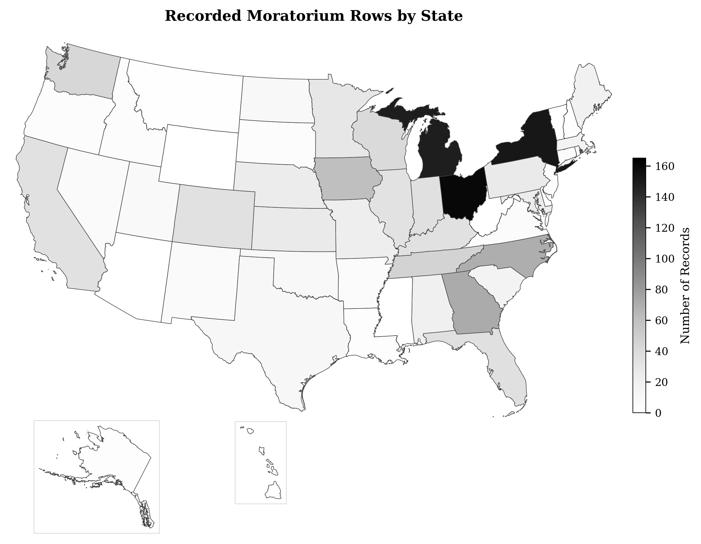

# Moratorium Data 2026

**November patch release with pending QA:** [v2026.11.9.post1](https://github.com/mjbommar/moratorium-data-2026/releases/tag/v2026.11.9.post1) publishes the reviewed current state with explicit unresolved source and legal-status questions. Further checking continues. The older `v2026.11.8` remains an incomplete prerelease checkpoint.

**Qualified patch:** This release incorporates the Boone County and Hampden duplicate retirements, reviewed field corrections and current QA ledger. Original `v2026.11.9` remains immutable. Further working changes may follow; use each tag for exact replication.

**Working QA after the patch:** [Foley’s adopted-file text](work/research/2026-11-09/post-release-qa/foley-review.md) now clarifies its conditional term, scope and exemptions. Wyoming’s retained-source review also resolves HB0155’s sponsor roster and leaves HB0325’s scope unresolved. Raw headline counts are unchanged; use the release tag for the immutable snapshot.

**Open data on local-government moratoria targeting data centers, battery storage, solar, wind, and cryptocurrency mining across the United States.**

This is the open companion dataset for the working paper *Moratorium Nation: A Survey of Data Center, Renewable Energy, and Battery Storage Moratoria in the United States*.

> 📄 **Working paper:** [April 2026 updated draft (PDF, 6 MB, 116 pages)](paper/moratorium-nation-2026-04-30.pdf) · [first edition on SSRN](https://papers.ssrn.com/sol3/papers.cfm?abstract_id=6242898). 50-state legal authority survey, 44-clause taxonomy, 13-section model ordinance template.

> **As of November 9, 2026, 1328 local moratorium records are tracked across 47 states.**
> Includes the reviewed November 6 Seattle duplicate retirement; both original IDs remain resolvable.
> Working-source review now covers all 1,777 raw records with primary and independent artifacts. [The integrated application](work/research/2026-11-08/full-inventory-integrated-application/README.md) records applied corrections, zero pending cells in the reviewed queue, full consistency checks and selected hosted verification. Status dates vary; bounded source review does not establish universal current legal force. The published November 8 checkpoint retains its older coverage.
>
> 🟢 **1088 classified active or extended** (current legal force remains record-specific) · 🟡 **64 classified pending** · ⚪ **170 classified past** (recorded as expired, replaced, or rescinded) · **2 rejected proposals retained** · **4 with unknown recorded stage**
>
> Leading states by total records: Ohio (160), New York (152), Michigan (148), Georgia (71), North Carolina (70), Iowa (60), Tennessee (46), Washington (43), Wisconsin (40), Florida (35), Indiana (35). Florida and Indiana tie for tenth.
>
> **Coverage note:** All 50 states were searched month by month for May–July 2026, but later discovery found additional instruments in that window. These are observed inventory counts, not a complete census. See [known gaps](docs/known-gaps.md).

[Reviewed ballot results](docs/ballot-results.md) cover **57 proposal and measure records** (**52 voted, 3 scheduled, 1 litigated, 1 unknown**), tracked separately from the legacy moratorium counts; **3 frozen candidate payloads remain withheld**; a separate [Augusta notice-only record](work/research/2026-11-08/augusta-notice-publication/README.md) may overlap one of those payloads, so these are not disjoint contest counts. Its sector, final wording, result and ordinance linkage remain unknown. The [Bethel Article 3 publication](work/research/2026-11-08/bethel-town-meeting-publication/README.md) adds an official October town-meeting question and a source-reported approval without a tally, certification or legal-effect finding. The [Monroe and Sprigg publication](work/research/2026-11-08/adams-ballot-publication/README.md) adds two general-zoning questions with unofficial observations and unknown sector and legal effect. The total includes [Jay's solar ballot](work/audit/jay-solar-ballot-followup-2026-11-06.json), reviewed after the original frozen cohort; its primary return and operative legal history remain unresolved. The separate [Wilmington initiative history](work/research/2026-11-07/wilmington-initiative-history/README.md) records dated litigation and an intended election, without a vote result or finding of later status. Two [Clarksville referrals](work/research/2026-11-07/clarksville-proposal-publication/README.md) are conditional future proposals with unknown final election dates and ballots. A vote, certification and an operative legal restriction are distinct observations. Legal-effect review remains record-specific.

Latest reviewed corrections: [full-inventory integrated application](work/research/2026-11-08/full-inventory-integrated-application/README.md), [next 90 records and stage corrections](work/research/2026-11-08/full-inventory-next90-application/README.md), [first 105 additional records](work/research/2026-11-08/full-inventory-first105-application/README.md), [final 225-record cohort corrections](work/research/2026-11-08/freshness-225-final-corrections/README.md), [30-record source reconciliation](work/research/2026-11-08/freshness-followup-reconciliation/README.md), and [first twenty-record reconciliation](work/research/2026-11-08/freshness-first20-reconciliation/README.md). All IDs are preserved; unsupported dates, terms and authority claims are qualified. The [full record-disposition funnel](work/research/2026-11-08/full-record-dispositions/README.md) retains 1,444 bounded unresolved records, 130 corrected-resolved, 201 confirmed-unchanged and zero active superseded duplicates; these are scoped review findings, not current-law totals. **979 rows carry verification flags**, while absence of a flag is not a current-force guarantee. See the [changelog](CHANGELOG.md) and [remaining evidence gaps](docs/known-gaps.md).

The linked April 2026 paper is a historical edition. Its figures and conclusions have not been synchronized to this November dataset.



[Figure editions and denominators](figures/README.md) distinguish current record summaries from the historical paper’s legal classifications.

---

## Quick links

|  |  |
|---|---|
| 📄 **Read the paper** | [April 2026 draft PDF](paper/moratorium-nation-2026-04-30.pdf) · [first edition on SSRN](https://papers.ssrn.com/sol3/papers.cfm?abstract_id=6242898) |
| 🗺️ **Find your state** | [Browse the 47-state index →](states/README.md) |
| 📊 **Get the data** | [`data/moratorium_inventory.csv`](data/moratorium_inventory.csv) (Excel-ready) |
| 📖 **Read the FAQ** | [What is a moratorium? Why does this dataset exist? →](docs/FAQ.md) |
| 🧪 **Reproduce the analysis** | [`docs/methodology.md`](docs/methodology.md) |
| 📚 **Cite this dataset** | [How to cite ↓](#how-to-cite) |

---

## What is in this repository

This repository contains four kinds of artifacts, each in its own folder:

| Folder | What's inside | Best for |
|--------|---------------|----------|
| [`states/`](states/) | One human-readable Markdown page per state, listing every moratorium in plain English. | Anyone who wants to know what's happening in a specific state. |
| [`data/`](data/) | The underlying data — CSV files for spreadsheets, JSON for programmers. | Journalists, analysts, researchers. |
| [`figures/png/`](figures/png/) | Seven maps as PNG images, with PDF and SVG copies in the folders beside it for print. | Anyone making slides, articles, or reports. |
| [`tables/`](tables/) | LaTeX-formatted tables (already pre-built, drop-in). | Academics writing papers. |

We also include the [scripts](scripts/) and [methodology](docs/methodology.md) so anyone can re-run the analysis and audit our choices. Everything outside `data/` is generated: `make all` rebuilds every table, figure, and page from the two source CSVs, and `make validate` checks those CSVs against the [codebook](docs/codebook.md).

---

## What is a moratorium?

A **moratorium** is a temporary pause that a local government — usually a city, county, or township — places on accepting or approving certain kinds of new development. While the moratorium is in effect, no one can apply for permits to build the kinds of projects it covers. The pause is meant to give the local government time to study the impacts and write permanent rules.

**Why are these moratoria happening?** Local governments have been caught flat-footed by the speed of new infrastructure proposals — particularly hyperscale data centers (often 100+ megawatts) and large battery-storage facilities. Existing zoning codes, written decades ago, don't define or regulate these uses. A moratorium buys time to catch up.

**Are these moratoria permanent bans?** No. Almost all are time-limited (typically 6 to 12 months) and have an automatic expiration date. A small number have been extended; some have been replaced by permanent regulations; a few have been rescinded.

For more, see the [FAQ](docs/FAQ.md).

---

## The headline numbers

Working snapshot during the **November 5, 2026** refresh (record-level source dates vary):

- **1328 moratorium records** tracked in our working inventory
  - **1088 classified active or extended** (891 active + 197 extended)
  - **64 classified pending**
  - **81 classified replaced**
  - **77 classified expired**
  - **12 classified rescinded**; earlier event-based expiry may remain unresolved
- **47 states** have at least one moratorium. We searched the other **3 states** (Hawaii, West Virginia, and Wyoming) and found none. Alaska, Arizona, Delaware, Rhode Island, and Vermont joined the list in the September 2026 update
- **Leading states by record count**: Ohio (160), New York (152), Michigan (148), Georgia (71), North Carolina (70), Iowa (60), Tennessee (46), Washington (43), Wisconsin (40), Florida (35), Indiana (35). Florida and Indiana tie for tenth.
- **Sectors covered**: most moratoria are about **data centers** (about 84% mention them). **Battery storage** comes next (about 19%). Most of those are New York town pauses added in September 2026. Smaller numbers cover **cryptocurrency mining**, **solar**, and **wind**
- **426 state-policy records** use the legacy `bill` type, alongside **12 resolution rows**, **3 precursor memo rows**, **1 amendment row**, and **5 other typed actions**. These are legal-form row counts, not a deduplicated independent-bill census. [Reviewed analytical scope decisions](data/state_policy_scope_reviews.jsonl) are applied to [separate scope exports](docs/policy-scope-exports.md); raw totals retain historical out-of-scope rows. The registry currently includes 375 observations, excludes 19, leaves 53 reviewed-unresolved and 0 unreviewed; the 428-observation exploratory candidate pool is not a reviewed infrastructure census. The [Maryland review](work/research/2026-11-07/maryland-policy-source-review/README.md) separates Senate companions and adds the governor’s conditional state-review order; it does not assert a statewide construction moratorium or renewed current force. Compound resolution observations and memo-to-bill associations retain their existing IDs. Mechanisms include moratorium proposals, local authority/preemption, permitting limits, and utility-grid restrictions; filter `policy_instrument_type`, `policy_mechanism`, `legal_effect_status`, and `scope_of_action` rather than treating every state row as a moratorium.
- **348 moratorium texts** read line-by-line and coded against a 44-clause taxonomy (the confidence-≥-0.4 subset of the 526 successful structured extractions in [`data/structured_extractions.jsonl`](data/structured_extractions.jsonl)). ⚠️ This cohort covers 211 jurisdictions and was collected **before 2026-04-28** — it was not re-run in v2026.07, so the clause-level percentages describe only about a quarter of the current inventory. See [known gaps](docs/known-gaps.md)
- **1287 of 1328 records geocoded** with WGS84 lat/lon (96.9% coverage); the 41 blanks comprise two aggregate meta-rows and Hayward, Fairbanks North Star Borough, Petersburg Borough, Braintree, Methuen, Sun Prairie, two Kent County records, Brighton, Chicago, Sac County, the 2023 Sioux County record, the historical Silver City solar record, Orlinda, Blaine County, Sarpy County, Pequot Lakes, the historical Talbot County solar record, East Windsor, two historical Phillips County records, Fort Collins, Vermillion County, Zionsville, Union County, Camargo, Bossier Parish, Mooresville, Awendaw, Stephenson County, Whitman County, Spokane Valley, Niagara, Massena, two Locke Township records, Meridian Township, Bridgton and Ashland, whose coordinates await review. In September 2026 we found 37 rows placed in the wrong county, because many townships share a name, and fixed them ([audit details](docs/known-gaps.md#geocoding-caveats-added-v2026042))

Full state-by-state breakdown: [**states/README.md**](states/README.md).

The headline counts inventory records, including proposals. The intended grain is one instrument per row, but aggregate and compound rows and possible duplicates remain unresolved. Recorded status classifications do not establish current enforceability. Use `enacted_status` to filter classifications; the codebook explains.

---

## How to use the data

### Open in Excel or Google Sheets

Download [`data/moratorium_inventory.csv`](data/moratorium_inventory.csv) and open it in Excel, Google Sheets, Numbers, or any spreadsheet tool. The intended grain is one instrument per row; aggregate and compound rows and possible duplicates remain unresolved. Column definitions are in [`docs/codebook.md`](docs/codebook.md).

To select records classified active or extended, filter the `enacted_status` column to `active` or `extended`.

### Load with Python (pandas)

```python
import pandas as pd
df = pd.read_csv("https://raw.githubusercontent.com/mjbommar/moratorium-data-2026/main/data/moratorium_inventory.csv")
in_force = df[df["enacted_status"].isin(["active", "extended"])]
print(in_force["state"].value_counts().head(10))
```

### Load with R

```r
df <- read.csv("https://raw.githubusercontent.com/mjbommar/moratorium-data-2026/main/data/moratorium_inventory.csv")
in_force <- df[df$enacted_status %in% c("active", "extended"), ]
sort(table(in_force$state), decreasing = TRUE)[1:10]
```

### Make a map in 30 seconds

Every row has `latitude` and `longitude` columns. Drop the CSV into [Mapbox Studio](https://www.mapbox.com/studio), [kepler.gl](https://kepler.gl/), [Datawrapper](https://www.datawrapper.de/maps/), or [QGIS](https://qgis.org/) and you have an instant point map. Or in 5 lines of Python:

```python
import pandas as pd
import folium
df = pd.read_csv("https://raw.githubusercontent.com/mjbommar/moratorium-data-2026/main/data/moratorium_inventory.csv")
m = folium.Map(location=[39.5, -98.5], zoom_start=4)
df.dropna(subset=["latitude","longitude"]).apply(
    lambda r: folium.CircleMarker([r.latitude, r.longitude], radius=4,
        popup=f"{r.jurisdiction}, {r.state} ({r.enacted_status})").add_to(m), axis=1)
m.save("map.html")  # open in browser
```

### Just want the numbers

[`data/summary_stats.json`](data/summary_stats.json) is a small JSON file with the headline totals (counts by state, breakdown by enacted-status, etc.). The internal summary key `in_force` used by the page generator counts rows classified active or extended; it does not measure current legal force.

---

## How to cite

> Bommarito, Michael J. (2026). *Moratorium Nation: U.S. Infrastructure Moratorium Data* (April 2026 release) [Data set]. https://github.com/mjbommar/moratorium-data-2026

If you cite the underlying paper:

> Bommarito, Michael J. (2026). *Moratorium Nation: A Survey of Data Center, Renewable Energy, and Battery Storage Moratoria in the United States.* SSRN Working Paper No. 6242898. https://papers.ssrn.com/sol3/papers.cfm?abstract_id=6242898 (first edition; April 2026 updated draft available as [PDF in this repo](paper/moratorium-nation-2026-04-30.pdf)).

A `CITATION.cff` file is included in the repo so GitHub renders a "Cite this repository" button automatically.

---

## License

- **Data** (`data/`, `states/`, `tables/`, `figures/`) is licensed under [Creative Commons Attribution 4.0 (CC-BY-4.0)](LICENSE-data). You can reuse, redistribute, and remix the data, including commercially, as long as you credit the source.
- **Code** (`scripts/`, `notebooks/`, `examples/`) is licensed under the [MIT License](LICENSE-code).

The latest qualified release is [v2026.11.9.post1](https://github.com/mjbommar/moratorium-data-2026/releases/tag/v2026.11.9.post1), published November 9 with explicit pending QA. September 23 remains the historical comparison baseline. Pin the release tag for replication; working main may contain subsequent reviewed corrections. Historical version labels describe their dated editions, and no DOI is asserted.

---

## Status, gaps, and how to contribute

This dataset is built from public records (municipal websites, board meeting minutes, news coverage) plus AI-assisted research. We are confident in **what we have**, but we know we don't have everything — small townships often don't post agendas online, and our automated tools sometimes can't reach behind authentication walls.

- **Found a moratorium we missed?** [Open an issue](https://github.com/mjbommar/moratorium-data-2026/issues/new?template=new-moratorium.md) — we'll add it in the next release.
- **Found an error?** [Submit a correction](https://github.com/mjbommar/moratorium-data-2026/issues/new?template=correction.md).
- **Question about the data?** [Ask here](https://github.com/mjbommar/moratorium-data-2026/issues/new?template=question.md).

Known gaps and limitations are documented in [`docs/known-gaps.md`](docs/known-gaps.md).

---

## Acknowledgments

This dataset was built using AI-assisted research agents to scan municipal websites, agenda portals, board minutes, and legislative trackers across all 50 states, supplemented by manual verification of high-priority entries. The methodology is documented in detail at [`docs/methodology.md`](docs/methodology.md).

Contact: [michaelbommarito.com/contact](https://michaelbommarito.com/contact/).

---

## Repository map

```
moratorium-data-2026/
├── README.md                      # this page
├── paper/                         # working paper PDF (April 2026 draft)
├── states/                        # 50-state index + per-state pages
├── data/                          # canonical CSVs and JSON
│   ├── moratorium_inventory.csv   # the 1330-row local-moratorium table
│   ├── state_legislation.csv      # 447-row state-policy tracker with typed legal forms
│   ├── summary_stats.json         # top-level aggregates
│   ├── structured_extractions.jsonl  # 864 lines (526 successful + 338 errors)
│   └── clause_extraction_analysis.json  # n=348 cohort summary
├── figures/                       # PNG (web), PDF (print), SVG (vector)
├── tables/                        # pre-rendered LaTeX tables
├── docs/                          # FAQ, methodology, codebook, known gaps
├── scripts/                       # generators (rebuild tables/maps from data)
├── notebooks/                     # Jupyter examples (planned)
├── examples/                      # one R / one Python example script
├── Makefile                       # make all | make validate | make check
├── work/                          # refresh machinery: schemas, packets, audit logs
├── CITATION.cff                   # citation metadata
├── LICENSE-data                   # CC-BY-4.0 for data
└── LICENSE-code                   # MIT for scripts
```
